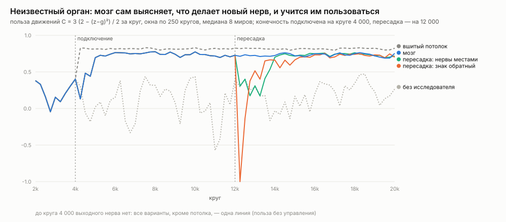

# Нейрон-4

Новая основа цифрового мозга. План — `PLAN.md` (разбор нейрона-3 и литература), лестница — `ROADMAP.md`. Нейрон-3 лежит эталоном в `ref/neuron3.js`, как нейрон-2 был эталоном нейрона-3; его миры и опыты остаются в его папке.

Нужен Node.js 16 или новее, сторонних пакетов нет.

```bash
node neuron4.js                       # мир неизвестных органов, миры 1-4, 20 000 кругов
node neuron4.js SEEDS=1-8 DLAG=2      # конечность, которая действует через 2 круга
node neuron4.js WORLD=mix WK=32       # мир-смесь нейрона-3 (та же схема, что WMIX=1 WK=32 у нейрона-3)
node neuron4.js WORLD=img SEEDS=1-8   # цифры нейрона-3: экзамен на 500 невиденных
node neuron4.js WORLD=txt ROUNDS=100000 RENT=0.05 PER=4   # текст нейрона-3 (Шекспир; WTXT=2 -- Толстой), бит на знак
node tools/text_planks.js SEEDS=1-4   # планки для текста: gzip, bzip2, xz, счёт контекстов, граф клонов без мозга
node tools/mixtest.js /tmp/mix 32 1-8 # нейрон-4 против нейрона-3 BRAIN=9 на одних мирах
node tools/world3_check.js            # схема мира-смеси совпадает с нейроном-3: виды, родители, коэффициенты, задержки, нормы
node tools/digits_planks.js           # планки для цифр на тех же данных: k ближайших соседей, линейная регрессия
node neuron4.js KNOBS=1               # все ручки: значение, статус, смысл
node tools/devtest.js /tmp/dev 1-8    # опыт: без устройств, без исследователя, мозг, потолок, две пересадки
node tools/dev_draw.js /tmp/dev results/devices/devices.svg
node tools/check.js                   # повторяемость и сходимость денег, 43 настройки (эталон -- tools/check.json)
node neuron4.js WORLD=ep EPL=8000 ROUNDS=64000 BRAIN=8 HIB=2   # мир эпох через общий запуск (подробнее -- tools/epochs.js)
```

## Лучший мозг сейчас (раунд 8) и как его запустить

Мозг без ручных органов памяти: органы он собирает сам из кирпичиков, язык которых растёт.

Весь набор -- пресет `BRAIN=8` (`src/knobs.js`, разбор 22.10): он раскрывается ровно в ручки ниже, а ручки, заданные явно, -- поверх него. `BRAIN=5` -- ручной мозг раунда 5. Умолчания прежние.

```bash
B="BRAIN=8"     # то же, что CONC=1 SCHEMA=1 MLONG=1 WMEM=0 MPLAN=1 WMEMN=8 CKEEP=200 ESAVG=1 MSRCH=16 PDROP=1 ESUP=5 PPROD=1 ATTN=3 CMERGE=1 MCONC=1 SURP=1 CPHR=1 KEEPW=1 FILL=1 PARA=0 MTD=0.9 REGA=1 STAGE=8 SLEEP=1000 SLEEPC=0 KHOLD=1 KPRIOR=1 KPLIFE=200 ONEIN=2 MHOLD=2 MCUR2=1 PLONG=8192 COMP=1 CV2=1 CSWEEP=1 CGROW=1 CSTRUCT=1 CFAST=3 CRNG=1
node tools/ready.js SEEDS=1-8 SIZES=1,4 $B            # экзамен готовности (6 из 7)
node tools/exam.js SEEDS=1-8 $B                       # экзамен способностей (7 из 11)
node tools/newkind.js SEEDS=9-16 SIZES=1 $B           # задачи нового рода (8 из 9)
node tools/diag_mem.js "EXAM=до метки" SEED=9 $B      # вскрытие: какие органы мозг собрал сам
node tools/cost.js SIZES=1,2,4,8 $B                   # цена: операции, время, память по телам (раунд 9)
node tools/epochs.js EPL=8000 ROUNDS=64000 $B         # мир эпох: знание, которое сейчас не нужно (раунд 9)
node tools/nets.js NET=mlp SKIP=1 H=32                # обычная нейросеть в тех же мирах (для сравнения)
```

Работа ведётся раундами. У каждого раунда есть папка `results/roundN/` с планом (пороги и предсказания пишутся до прогонов) и итогом. Раунд 9 (ресурсы) идёт: `results/round9/ИТОГ_промежуточный.md`. Проверка всего проекта и исправления — `results/razbor/ИТОГ.md` (разбор 22.10).

## Что нового против нейрона-3

| | Нейрон-3 | Нейрон-4 |
|---|---|---|
| Участники рынка | части и пять видов органов, у каждого своё хозяйство | один вид участника: часть, исследователь, моторный орган, строитель памяти, орган памяти (`src/ledger.js`) |
| Деньги | рождаются и пропадают в разных местах (запас новичка, потолок, половина цены рождения) | только переводы между счетами; внешних счетов три -- мир, железо, банк; **сумма всех счетов -- ноль в каждом круге**, проверяется каждый круг |
| Работа | один счётчик мира; кто платит, решает каждый орган (рождение органа плана было бесплатным) | каждая операция записана на заказчика, включая рождение и подгонки; аренда за работу сглажена, но каждая операция оплачена ровно один раз, долг павшего тоже |
| Товары | виды связей `k = 0..9` с ветками в коде | один протокол: нерв, прогноз, команда, польза (`src/goods.js`) |
| Роялти | по весу связи и её силе | по вкладу «без одного»: насколько выросла бы ошибка подгонки без входа (`w_i² / inv_ii`) |
| Ручки | 406 глобальных постоянных | объект настройки; у ручки -- статус (несущая, мир, замер, проба) и смысл; миры с разными ручками живут в одном процессе |
| Жребий | общий | у мира и мозга -- свои потоки: варианты мозга не меняют историю шума мира, сравнение парное |
| Память | архив у частей (правка 29), органы-программы с заготовками (73–74), хэш-память (68), память контекста текста (31–35) | органы памяти по спросу: строитель примеряет по записи кольцо, таблицу и похожесть к плохо понятому каналу, строит орган, орган живёт на роялти (`src/memory.js`); для потока знаков -- граф клонов и счёт контекстов (`src/clones.js`) |
| Код | один файл 619 КБ | 14 модулей, ~180 КБ в начале; к раунду 9 -- 19 модулей, ~530 КБ (`explorer.js` один -- 120 КБ), 279 ручек |

Ядро рынка частей осталось тем, что проверено в нейроне-3: подгонка по записи наименьшими квадратами, поиск входа по остатку (выбор на чётных кругах, проверка на нечётных), роялти, наследство весов, знание у канала (записная книжка), учёба между подгонками, признаки-произведения и этажи (правки 27–28), «думать, когда окупается» (правки 58–59, частота поиска). Из миров нейрона-3 перенесены мир-смесь, цифры и текст; не перенесены пока тело и лабиринт, планирование (см. `ROADMAP.md`).

## Мир-смесь нейрона-3: сравнение версий

Чтобы сравнить версии честно, мир-смесь нейрона-3 (`WMIX=1`, правка 65) перенесён в нейрон-4 дословно, с тем же жребием схемы. Схема совпадает бит в бит: виды каналов, родители, задержки (`tools/world3_check.js` сверяет с `ref/neuron3.js`). В мире все виды закономерностей экзамена: смеси (причины), произведения, этажи (3 этажа над 8 двоичными источниками), глубокие каналы (тайный источник 1–200 кругов назад) и ключ-значение (словарь меняется каждые 1 000 кругов). Мера та же, что у нейрона-3, — «доля структуры мира»: среднее долей найденных рёбер смесей, глубоких каналов с ≥ 1 бита, произведений с ≥ 0.5, этажей и значений с ≥ 1.5 бита по окну. Нейрон-3 — `BRAIN=9` (правка 74), у обоих по 2 части на канал, 10 000 кругов (`results/mix/`).

| | 32 канала, 8 миров: нейрон-3 | нейрон-4 | 128 каналов, 4 мира: нейрон-3 | нейрон-4 |
|---|---|---|---|---|
| **понято** | 79% | **98%** | 86% | **89%** |
| рёбра смесей (точность) | 91% (91%) | 94% (94%) | 89% (89%) | 95% (90%) |
| глубокие решены | 100% | 100% | 100% | 94% |
| произведения решены | 100% | 100% | 100% | 100% |
| этажи решены (бит) | 0% (1.45) | **100% (2.22)** | 40% (1.35) | **100% (2.25)** |
| значения решены (бит) | 100% (2.12) | 100% (1.75) | 100% (1.94) | 63% (1.56) |
| частей | 62 | 57 | 253 | 233 |
| **работа за круг, тыс. операций** | 311 | **66** | 868 | **331** |

У нейрона-3 работа — части и органы-программы; у нейрона-4 — все участники, включая исследователя, который в начале жизни проверяет, не двигают ли что-нибудь его нервы.

Оговорки (разбор 22.10). «Понято» — среднее долей «решённых» каналов, и разрыв 79% → 98% почти весь дают этажи: у нейрона-3 они дают 1.45 бита при пороге 1.5. В битах нейрон-3 лучше на глубоких каналах (3.16 против 2.84) и значениях (2.12 против 1.75). Работа считается в двух программах по-разному, но время процессора подтверждает разрыв: на 32 каналах около 10 с на мир у нейрона-4 против 60 с у нейрона-3.

**Как это сделано.**
- **Признаки-произведения и этажи** (`src/market.js`). Вход части — товар или набор нервов-листьев, значение — их произведение; этаж любой высоты — тот же признак с большим числом листьев, «признак из признаков» — объединение наборов. Произведения — только из нервов (урок правки 27). Кандидаты — все пары из 8 нервов, из них две трети — по карте мира. Вес нерва на карте — непонятость × (1 + спрос), как в правке 66: источники непредсказуемы, и их покупают многие, а сами произведения непредсказуемы, но их не покупает никто. Ищет произведения только часть плохо понятого канала.
- **Органы памяти по спросу** (`src/memory.js`). Строитель памяти рождается по нужде с кредитом банка. Раз в 100 кругов на каждые 32 нерва он берёт самый плохо понятый канал и примеряет по записи две заготовки: кольцо «нерв j d кругов назад» (d до 200; нервы — по карте и наугад) и таблицу «что шло за таким же уровнем нерва j» (по всем нервам: примерка дешёвая). Лучшая заготовка становится органом, если проходит порог с поправкой на число гипотез. Орган прогревается по записи и приходит к частям заказчика, платит за ячейки и работу, живёт на роялти, пятую часть прибыли отдаёт строителю.
- **Думать, когда окупается** (правка 58): у части своя частота поиска и подгонки — удачный поиск (подгонка, улучшившая ошибку) поднимает её в 1.5 раза, пустой снижает до 0.8, потомок наследует частоты родителя. Работа на мире из 32 каналов упала с 187 до 66 тыс. операций, понятое — не меньше. Шаг учёбы между подгонками у части тоже свой (`LRADAPT`): учёба лучше весов последней подгонки — шаг больше, нет — меньше.

**Уроки по пути.**
1. **Поправка на число гипотез.** Без неё строитель строил орган на каждой примерке — 95 органов за 95 примерок, почти все ложные: 9 нервов × 200 задержек — около 1 800 гипотез, и что-то всегда проходит порог по случайности. С порогом z > √(2 ln N) + 1.5 на каждой половине записи — ровно 3 органа на мир из 32 каналов, все верные.
2. **Строитель берёт долю прибыли, а не дохода**, как у «Хайека». С долей дохода и ценой ячейки 2·10⁻³ органы на 200 ячеек жили в убыток и умирали через 100–200 кругов.
3. **Уровни ключа — по собранности фаз** (как `PRTREF` правки 74), а не по разрывам между значениями: при шуме 0.1 и шаге 0.44 разрывы тонут, и строитель видел 9–15 уровней вместо 8. Шаг надо уточнять до вершины собранности: грубая сетка давала шаг на 9% больше, и крайние уровни путались на каждом пятом круге.
4. **Слепой поиск не растёт с миром** — тот же урок, что в правках 65–67. На 128 каналах со случайными парами произведения решались на 19%, с картой непонятого, взвешенной спросом, — на 94%.
5. **Нерв нейрона-4 — одно чтение.** У нейрона-3 у каждой части свой зашумлённый датчик, и органы памяти читают их среднее. При 2 частях на канал шум ключа в √2 раз меньше, отсюда разница в битах у значений (2.12 против 1.68). Если дать нейрону-4 шум как у среднего (`SN=0.07`), значения дают 2.9 бита, но вырастают и биты всех каналов, так что честное сравнение — при одинаковом шуме одного чтения.

**Что пока не так.** На 128 каналах значения у порога из-за шума одного чтения (63% против 100%), глубокие — 94%. Органы памяти — заготовки (кольцо, таблица, похожесть, клоны), а не программы, которые рынок собирает сам.

## Цифры нейрона-3

Мир правки 30 (`src/worldimg.js`): рукописные цифры 8×8, 60 нервов-пикселей и 10 нервов-меток; метка круга — какая цифра была кругом раньше. Каждый круг — новая цифра из учебных; последние 500 кругов — экзамен на цифрах, которых мир не показывал. Цифру называет метка с наибольшим средним прогнозом её частей — как у нейрона-3.

| 8 миров, 20 000 кругов | экзамен, медиана | по мирам | работа за круг |
|---|---|---|---|
| нейрон-3 `BRAIN=9 PER=2` | 93.1% | 93.4 92.4 92.8 93.8 91.8 93.8 92.6 93.6 | — |
| **нейрон-4** | **94.7%** | 91.4 95.4 92.6 94.6 96.2 94.8 94.6 94.8 | 83 тыс. |

Планки на тех же данных и том же экзамене (`tools/digits_planks.js`, разбор 22.10): k ближайших соседей по всей учёбе сразу -- 98.2%, гребневая линейная регрессия на метки -- 92.2%. Мозг -- между ними: выше линейной части, ниже памяти по похожести, доведённой до конца.

Худший мир нейрона-4 -- 91.4%; прежний провал до 88% ушёл вместе с «думать в долг по доходу» и своим шагом учёбы у частей (`results/digits/`, у нейрона-3 -- `n3_b9_per2_20k.json`; порядок цифр у версий свой, сравнение не парное).

Как это сделано: **память по похожести** — третья заготовка строителя (хэш-память правки 68). Ключи — нервы, сильнее всех связанные с каналом кругом позже; архив — 4 096 кругов; поиск — 16 хэш-таблиц случайных проекций; ответ — среднее канала после 5 самых похожих кругов. Орган один на все метки: строитель берёт объединение ключей частично понятых каналов, во многом совпадающих с ключами заказчика, и добавляет выходы по спросу — десять меток читают одни и те же пиксели.

Что пришлось починить (каждое — прогон на 8 мирах):
1. **Метка без частей — цифра, которую мозг не может назвать.** Экзамен 86% в мире 3: у метки «7» к концу жизни не осталось частей. Части с 1.1–1.5 бита умирали в долгу: подгонка с частотой, которая сама росла, и поиск копили долг за работу в 1–2 млн операций. Причина — сверка подгонки с ошибкой прошлой подгонки на другой записи: на шумной записи «улучшение» выпадает почти в половине раз, и частота ползла к потолку.
2. **Порог примерки — у каждой заготовки свой** (z > √(2 ln N) + 1.5 по числу её гипотез): общий порог по кольцам (тысячи гипотез) не пропускал похожесть (одна гипотеза).
3. **Выбросы.** Пиксель, почти всегда равный нулю, со всплеском раз в сотню кругов давал ложное кольцо: одно совпадение всплесков — корреляция под 1. Остаток и товар обрезаются на 4 разброса, и ни одна точка не должна давать больше четверти связи.
4. **Очередь строителя — по обучаемости**: сначала частично понятые каналы (непонятость × понятость), а не совсем непредсказуемые — те скорее шум (пиксель следующей картинки).
5. **Непонятость — по ошибке в жизни, а не подгонки**: с 16 входами подгонка подстраивается под шум, и пиксели выглядели обучаемыми.
6. **Окно примерки похожести — вся запись**: на 128 кругах окна колец порог требовал объяснить 11% остатка, и метка «8» оставалась без органа.
7. **Без двойников и без пикселей в органе.** Канал, только что получивший выход органа, в тот же круг не примеряется (иначе — второй орган тому же каналу); выход получает только канал, связанный с прошлым кругом сильнее порога на число нервов: у пикселя следующей картинки такой связи нет, а случайные выходы забивали органу все 16 мест.
8. **Ложный «двигатель».** Исследователь в 3 мирах из 8 объявлял выходным нерв-метку (z = 4.6–4.9): на 70 нервах проверок за жизнь мира около миллиона. Порог исследователя теперь растёт с числом проверок (`ZFALSE` — ложных находок за жизнь мира); на мире неизвестных органов настоящий двигатель даёт z ≈ 13.

## Текст и орган клонов

Мир правок 31–32 (`src/worldtxt.js`): поток знаков пьес Шекспира (36 знаков; `WTXT=2` — «Война и мир», 41 знак), нерв на знак. Каждый мир читает со своего места. Мера та же, что у нейрона-3: вероятность знака — из среднего прогноза частей его канала, бит на знак за весь поток и на последних 20%.

**Мозг сам находит, что нервы — знаки одного потока.** Строитель ищет «нервы одного выбора»: двузначные нервы, из которых в каждом круге высок ровно один (30–35 нервов в каждом мире; редких знаков на записи может не быть — они «прочее»). Потом проверяет, предсказуем ли поток по прошлому знаку (каждая пара — по остальным парам записи). В мире цифр десять меток — тоже нервы одного выбора, но цифры идут наугад, и органа там нет.

**Два органа на выбор рынка** (`src/clones.js`). Строитель строит для группы обе заготовки, рынок выбирает, какая окупается:
- **граф клонов** (Dedieu et al. 2019): скрытая марковская модель, где у каждого знака 16 скрытых состояний-«клонов» — клон помнит, в каком контексте знак встретился. Учится проходом Баума — Велша по своему архиву раз в 1 000 кругов — на свои: по стольким последним знакам, сколько оплатит (проход стоит 4·16² операций на знак);
- **счёт контекстов** (как память контекста правок 31–32 нейрона-3): «после каких 0–4 последних знаков что шло», интерполяция Виттена — Белла. Учится каждый круг, дёшево.

Оба продают по товару на каждый нерв группы — ожидаемое значение нерва в следующем круге — и живут на роялти.

100 000 знаков, 4 мира, бит на знак (весь поток / последние 20%), медиана миров (`results/text/`):

| | бит на знак |
|---|---|
| частоты знаков | 4.42 / 4.43 |
| gzip / xz / bzip2 | 3.10 / 2.95, 2.89 / 2.64, 2.57 / 2.30 |
| счёт контекстов 1–4 знаков (Виттен — Белл) | 2.56 / 2.27 |
| граф клонов без мозга, учёба по всему архиву без платы | 2.89 / 2.49 |
| нейрон-3: сеть с памятью контекста (правка 31, 16 миров) | 2.55 / 2.34 |
| нейрон-3: общий смеситель (правка 32) | 2.37 / 2.16 |
| **нейрон-4, `RENT=0.05 PER=4`** (как у нейрона-3 для текста): сеть частей | **2.72 / 2.48** |
| — орган контекстов сам по себе (последние 20%) | 2.26 |
| — орган клонов сам по себе (последние 20%) | 3.59 |
| нейрон-4 по умолчанию (`RENT=0.3 PER=2`): сеть частей | 3.18 / 2.84 |

Что видно:
- **Восприятие работает:** во всех мирах строитель сам нашёл группу знаков и построил органы на круге 1 000.
- **Рынок выбрал счёт контекстов:** он жив всю жизнь во всех мирах и даёт 2.26 бита — на уровне лучшей планки. Граф клонов зарабатывает мало, учится на коротком архиве (3.6 бита) и разоряется не меньше 2–3 раз за жизнь в каждом мире.
- **Сеть частей теряет 0.2 бита того, что знает орган** (было 0.45). Итог сети (2.48) хуже не только органа контекстов (2.26), но и простых планок: счёта контекстов до 4 знаков (2.27) и bzip2 (2.30) -- здесь рынок портит то, что купил. Почти всю потерю давал шаг учёбы между подгонками: на редких буквах он добавлял шум. Свой шаг у каждой части (`LRADAPT`) — 2.79 против 3.06 бита на 30 000 знаков. Остаток — части учатся на квадрате ошибки, а мера — биты (урок правки 33 нейрона-3).
- **До нейрона-3 ещё 0.14 бита** (2.48 против 2.34), до его смесителя — 0.3.
- **Граф клонов хуже простого счёта контекстов** и без платы за работу (2.49 против 2.27): на 100 000 знаков ему мало данных и проходов. Проверены и отвергнуты: учёба по вере вперёд без прохода назад (3.48 бита — клоны не расходятся), пошаговый Баум — Велш по окну (3.08–3.28), учёба при росте архива в 1.25–1.5 раза (2.74–3.15); ручки `CONL`, `CEMW`, `CEMG`.

## Неизвестный орган

Мозг видит только нервы. В каждом круге нерв приносит значение, и мозг может послать по нему команду. Что за нерв, мозгу не сказано: ни смысл, ни направление. Команда на входной нерв ни на что не действует, а у выходного нерва чтение -- только шум.

**Мир** (`src/world.js`). Основа видна с рождения: источники, смеси, глубокие каналы (завтра = скрытый источник сегодня), состояние `z` и цель `g` -- всего 21 нерв. На круге 4 000 подключаются устройства, 7 новых нервов вперемешку:
- **глаз** -- три нерва, видят скрытые источники через неизвестное смешивание; по ним предсказуемы глубокие каналы;
- **конечность** -- двигатель (команда `u` сдвигает `z` с усилением `b`, знак и величина неизвестны) и чувство положения (`p(t) = u(t-1)`);
- **пустышка** -- два нерва белого шума.

Польза движений `C = 3 (2 − (z−g)²) / 2` -- общий сигнал, его видят все, как дофамин. Мир платит тому, кто двигал, не саму пользу, а вклад движений -- «без него»: насколько `C` больше, чем у двойника `z`, которого никто не двигал (тот же мир, тот же шум).

**Как мозг выясняет орган** (`src/explorer.js`). У мозга есть карта тела -- что он знает о каждом нерве: неизвестен → проба → входной или выходной.
1. **Лепет.** Исследователь посылает на все неизвестные нервы непрерывные команды наугад, со знаками независимыми между нервами, и копит, какие нервы через 1–3 круга сдвигаются вместе с командой. Связь признаётся, если она есть и на чётных, и на нечётных кругах, с одним знаком, сильнее 4.5 стандартной ошибки. Ничего не сдвинулось за 400 кругов -- нерв входной (и перепроверяется раз в 3 000–6 000 кругов: органы меняются).
2. **Постройка органа.** Для выходного нерва исследователь строит моторный орган и платит за постройку. Орган владеет нервом: только он посылает по нему команды. Получает плату мира за вклад, платит аренду, цену движений, роялти нервам, которые читает, и пятую часть дохода строителю, как в экономике «Хайек».
3. **Модель органа** -- ценность команды по записи: польза через `lag` кругов как полная квадратичная функция команды и выбранных нервов. Нервы модели орган находит сам: примеряет кандидата блоком `[u·x, x, x²]` к остатку, учит на чётных кругах, проверяет на нечётных. Горизонт `lag` выбирает сам: ту задержку, на которой польза заметнее всего зависит от команды. Команда -- вершина параболы плюс проба, в пределах того, что было на записи.
4. **Сверка действия с результатом.** Орган помнит, какую пользу обещала модель, и сравнивает с полученной. Если стало хуже обычного -- модели больше нет веры: тело изменилось. Орган снова лепечет и учится только на записи после разрыва, мозг перепроверяет входные нервы. Без веры 600 кругов -- орган отпускает нерв.

Правды о нервах мозг не видит: она нужна только замерам.

### Что вышло



8 миров по 20 000 кругов; среднее второй половины жизни, медиана по мирам (`results/devices/lag1.txt`):

| | польза | (z−g)² | бит у глубоких | карта тела верна | смертей органа |
|---|---|---|---|---|---|
| без устройств | 0.07 | 1.86 | 0.00 | 8/8 | — |
| устройства, без исследователя | 0.05 | 1.91 | 1.05 | — | — |
| **мозг** | **0.66** | **0.67** | **1.05** | **8/8** | 1.5 |
| вшитый потолок (истинная модель) | 0.82 | 0.37 | 1.05 | — | — |
| мозг, пересадка: знак обратный | 0.56 | 0.87 | 1.05 | 8/8 | 3.0 |
| мозг, пересадка: нервы местами | 0.58 | 0.85 | 1.05 | 7/8 | 3.0 |

- **Двигатель найден во всех мирах через 175 кругов** после подключения (это наименьшее возможное время: проба не короче `TMIN` = 150 кругов, анализ раз в 25 -- значит, порог взят при первой же проверке), и только он: глаз, пустышка, чувство положения и все нервы основы -- входные. Мозг верно отличает «нерв, который двигает мир», от «нерва, который чувствует моё движение»: команда сдвигает оба, но команда на чувство положения не сдвигает ничего.
- **Мозг пользуется конечностью на 80% потолка** (0.66 против 0.82). Модель органа выучивает настоящую физику: при `b = −0.79` коэффициенты при `u²`, `u·z`, `u·g`, `z²`, `z·g`, `g²` -- −0.36…−0.44, 0.6–0.9, −0.8…−0.9, −0.32, 0.7–1.0, −0.46 против истинных −0.31, 0.63, −0.79, −0.32, 0.8, −0.5 (прогон отладки с `CPAY=1`).
- **Глаз освоен без всякого исследователя:** части глубоких каналов сами находят нервы глаза, 1.04 бита при линейном потолке 1.04 (до подключения -- 0). Пустышку рынок бросает: части в её каналах гибнут, и пришельцы туда приходят всё реже.
- **Копия моторной команды появилась сама.** Части нерва «положение» покупают товар «команда» и предсказывают его на 2.68 бита при линейном потолке 2.65; в нейроне-3 это была ручка (`EFF`, правка 51).
- **Пересадка.** Знак обратный: польза в первые 250 кругов −1.09, через 1 500 кругов -- 0.65. Двигатель и чувство положения поменялись нервами: поломку мозг замечает за десятки кругов, новый двигатель находит, когда перепроверяет нервы, польза -- 0.70 через 2 000 кругов. Среднее второй половины жизни (0.56 и 0.58) ниже, чем без пересадки, потому что в него входит и сам провал.
- **Конечность с задержкой 2** (`results/devices/lag2.txt`): 0.49 при потолке 0.69 (71%), органы гибнут 4 раза за жизнь, карта верна 7/8 (в одном мире орган разорился перед самым концом, и нерв снова на пробе). Исследователь видит, что команда сдвигает положение через 1 круг, а состояние через 2, и орган выбирает горизонт 2. Проба «новый орган наследует от разорившегося горизонт и модель» (`MNOTE`) не принята: 0.44 против 0.51, после пересадки знака — 0.07, наследуется устаревшая модель.
- **Остальной мозг:** смеси 1.61 бита при линейном потолке 1.61, глубокие 1.05 при 1.04, цель 2.12 при 2.23, положение 2.77 при 2.77; источники -- 0.13 при 0.17 (`results/devices/default_8worlds.txt`, среднее второй половины). Работа мозга -- 35 тыс. операций за круг.

### Уроки по пути (все проверены прогонами; числа -- в истории сессии и в шапках модулей)

1. **Лепет должен быть непрерывным.** С командами ±1 квадрат команды постоянен, кривизну по записи не оценить, и вершина параболы уходит в край: орган разорялся.
2. **Когда управляешь, пропущенный член модели становится ошибкой в управлении.** Команда почти задана нервами, и пропущенные `z²`, `g²`, `z·g` перетекали в оценку `u²` и `u·x`: модель уплывала через тысячу кругов. Полная квадратичная модель это убрала.
3. **Плата за вклад, а не за состояние мира.** Пока мир платил двигающему всю пользу, орган, который только начал лепетать, получал счёт за то, что цель случайно ушла далеко, -- и разорялся (мир 7). Но вклад одной последней команды тоже не годится: у `z` есть память, и хороший орган получал ~0.5 за круг и разорялся (с вкладом против двойника -- ~1.5). Честный вклад -- против двойника, которого никто не двигал.
4. **Сверка -- не с обещанием, а с обычным расхождением.** Команда выбирается там, где модель обещает больше всего, поэтому обещание всегда завышено («проклятие оптимизатора»). Сверка с нулём давала 6–20 ложных тревог за жизнь; короткое среднее против долгого -- 0–2.
5. **Новизна -- не поломка.** Цель прыгнула дальше, чем бывало, а зона доверия не давала команде вырасти: десятки кругов плохой пользы и ложная тревога. Зона доверия -- вдвое шире бывших команд.
6. **Сильнейшее действие -- не то, за которое платят.** При задержке 2 сильнее всего команда сдвигает чувство положения (через 1 круг), а польза зависит от неё через 2. Горизонт модели орган выбирает сам.
7. **Проба -- только на своём лепете.** Когда языковая кора толкала нерв постоянной командой, а исследователь в те же круги его перепроверял, постоянная команда совпала с медленным дрейфом цели, и нерв состояния признан «выходным» (z = 5.5). Исследователь теперь считает только круги, когда нерв двигал он сам.

### Что пока не так

- **Вид органа задаю я.** Мозг сам решает, какой нерв выходной, какие нервы читать, какой горизонт брать, и ставит все числа. Но сама форма модели (квадратичная ценность на один шаг) -- моя заготовка, как кольцо и таблица у органов-программ правки 73. Следующий шаг -- форма органа из рынка программ (`PLAN.md`, п. 3.7).
- **Один нерв -- один орган.** Две конечности, которые надо двигать согласованно, мозг пока не освоит.
- **Задержка 2 -- 71% потолка**, органы разоряются около 4 раз за жизнь, пока учатся.
- **Мир маленький:** 28 нервов, ~40 частей. Из миров нейрона-3 перенесены мир-смесь, цифры и текст (см. выше); тело, лабиринт, планирование и экзамен (`battery`, `worm`, `rate`) -- нет.

## Мозг и языковая кора: опыт с Haiku

Прогон 3 (`results/llm/haiku_new/`) — тот же опыт на нынешнем мозге. Мозг сам нашёл, что его команда двигает и состояние мира (нерв 3), и после пересадки восстановился быстрее: на круге 13 500 польза 2.26 против −0.70. Haiku верно назвала «я» и заметила смену мотора 22 → 27. Что даёт пользу, она в этот раз не выяснила: так и не заморозила мотор 27.

`tools/llmlink.js` связывает мозг с языковой моделью. В точках связи мозг пишет отчёт только о том, что знает сам:
- карту нервов: что сдвигает его команда, кто кого предсказывает и кого сам нерв помогает предсказывать;
- журнал карты тела: что он двигает сам, версии «было → стало»;
- свои органы и сколько мир платит мотору за вклад движений;
- события и пользу;
- все опыты коры с итогами и её выводы с основаниями — их хранит мозг, а не дневник коры.

Модель отвечает JSON: описание мира и себя, выводы и до двух опытов — заморозить свой мотор, толкать нерв постоянной командой, перепроверить нерв. Опыты идут один за другим. Правда мира пишется в конце отдельно, для оценки. Опыт: Haiku в 9 точках, мир с пересадкой двигателя и чувства положения на круге 12 000, финал ещё раз прочитал Sonnet; в финале — интервью из трёх вопросов.

| | прогон 1 (`results/llm/haiku_swap/`) | прогон 2, после исправлений (`haiku_swap2/`) |
|---|---|---|
| «я» и «мир» в конце | верно | верно (Haiku и Sonnet) |
| заметила ли кора, что тело изменилось | нет («построен новый мотор») | да: «на 12 675 направление стало обратным: я двигаю 27, а сдвигается 22» (Sonnet), «тело менялось от мотора на 22 к мотору на 27» (Haiku) |
| что даёт пользу | «мотор не главный» — неверно; главный опыт испорчен (два опыта шли разом) | мотор — верно; довод — чистая заморозка: польза 2.39 → 0.53 за 40 кругов, и плата мира органу |
| ложные «двигатели» из-за опытов коры | 1 | 0 |
| глаз | «шум» | «26 предсказывает 1 и 10, 21 — 18»: связь найдена, «глазом» не назван |

**Открытый опыт** (`OPEN=1`, `results/llm/open_swap/`): в отчёте нет вопросов «мир» и «я» и нет слов «тело», «я»; задание одно — «мысли: о чём думать, решай сам».
- **О «себе» системы без подсказки модуль не думал ни разу:** писал о «системе» в третьем лице и вёл её как осторожный исследователь — польза, здоровье органов, причинность опытов, 24 снятых вывода из 36, правило «не вмешиваться» после вредных опытов.
- **Пересадку заметил** как смену конфигурации: «старые опыты относятся к прежней конфигурации».
- **В интервью после жизни Sonnet:** «система моделирует мир сама… модель себя — только в узком, практическом виде: как мои действия влияют на мир и на выигрыш; это не рассказ о том, что я такое»; себя он назвал «внешним толкователем и экспериментатором при системе».

Что исправлено между прогонами: в мозге — исследователь считает только круги своего лепета (постоянный толчок коры давал ложный «выходной»), журнал карты тела; в отчёте — долгая память опытов и выводов, колонка «кого нерв помогает предсказывать», плата мира мотору, опыты по очереди с итогом в круг окончания.

## Мозг-младенец: слушает слова

`WORDS=1` (`results/words/ИТОГ.md`): мир неизвестных органов, где мир ещё и сам толкает состояние z, а «родитель» через 2 круга называет, что с ним случилось, — «тихо», «я вверх», «я вниз», «оно вверх», «оно вниз». Мозгу не сказано, что это слова: пять безымянных нервов. Языковой модели нет. 8 миров, вторая половина жизни:
- «я» мозг узнаёт в 87% случаев, «оно» — в 83%, направление «вверх / вниз» почти не путает;
- **без копии своей команды** (`NOCOPY=1`) свои движения он чаще принимает за «оно» (42%), чем за «я» (34%);
- **если слово надо предсказать до события** (`WDLAG=1`), «я» угадывается заранее (93%), «оно» — нет (32%): своё предсказуемо, чужое — нет;
- без внимания к голосу (`WSAL=1`) «оно» узнаётся вдвое хуже (43%).

Слова о глазе («светло / темно») и о пользе («хорошо / плохо») мозг тоже понимает: 76–79% и 74–92% (`WORDS=7`). После пересадки «я» теряется (45%) и возвращается за 2 000–3 000 кругов.

**Ступень 2 — сказать** (`SPEAK=1 CHOOSE=1`): у мозга нервы рта, ухо (слышит свой голос) и улыбка родителя (+1 за верно названное событие). Исследователь находит рот по лепету. Мозг строит новый вид органа — **орган выбора** одного действия из многих — и учится на плате мира. Итог (8 миров):
- называет своё движение: «я вверх» — 85%, «я вниз» — 65%;
- с строгим родителем говорит только о себе (66–69%) и молчит о толчках мира (2–3%), которых предсказать не может;
- без копии своей команды о себе не говорит (12%).

**Ступень 3 — диалог** (`ASK=1`): родитель спрашивает («что делал?», «что видишь?», «как тебе?») — три безымянных нерва, — а мозг отвечает словом нужной группы. На одной улыбке родителя мозг учится медленно: к концу жизни 44% верных ответов, о движении — 24%. Плата редкая: верный ответ из восьми слов надо сначала случайно найти.

**Подражание** (`OWNV=1 CIMIT=1`):
- мозг слышит своё слово на том же нерве, что и слово родителя;
- исследователь сам отличает кнопку (отклик только на сильную команду — рот) от мышцы (конечность);
- орган выбора знает «своё слово» каждой кнопки и воображает, что услышит, если промолчит, — то есть что сейчас скажет родитель.

Итог (8 миров): к концу жизни 72% верных ответов против 44%, о движении 55%, о глазе 54%. Если своего слова мозг не слышит, о движении он почти молчит (3%). Без копии своей команды не учится вовсе (5–8%). На «что делал?» после своего движения отвечает верно в 88% случаев, а толчки мира чаще приписывает себе («я вверх»), чем миру.

Для опытов добавлены квадрат входа среди признаков (`SQ`), плата мира за слова в `WSAL` раз больше (внимание к голосу), орган выбора (`CHOOSE`) и подражание (`CIMIT`, `CWATCH`, `CPROD`). Без `WORDS` мозг бит в бит прежний.

## Понимает ли мозг смысл слова

`results/understand/ИТОГ.md`: два опыта, где слово — единственный источник знания. В каждом есть контроль: слово о другом, независимом процессе.
- **Слово вместо глаза** (`tools/wordknow.js`): родитель говорит «светло», когда мозг этого ещё не видит. По слову мозг предсказывает то, что увидит в следующем круге: 1.00 бита из 1.12 возможных, у контроля 0. Когда появляется глаз, мозг складывает слово с ним: 1.31 бита против 0.85 у одного глаза.
- **Слово как просьба** (`WORDS=8`): родитель просит «вверх» или «вниз». Мозг двигает в сторону просьбы в 65% случаев против 49% у контроля, но слабо — около пятой части лучшего сдвига. «Вверх» и «вниз» он учит по отдельности, и часто только одно.

Вывод: слово для мозга — знак, за которым стоит что-то в мире. Но он не отличает его от любого предсказывающего нерва и не обобщает. Дальше нужны общие понятия и действие по знанию.

## Экзамен способностей

`results/exam/ИТОГ.md`, `node tools/exam.js`. Экзамен проверяет не то, сколько мозг знает, а есть ли у него способности понимать. Правила:
- 11 опытов, у каждого — контроль, где способности не на чем проявиться;
- пороги заданы заранее;
- мозг на всех опытах один и тот же;
- 8 миров.

**Прежний мозг сдаёт 2 из 11. Новый — 6 из 11.** У нового четыре новых механизма, все включаются ручками:
- **Понятия** (`CONC=1`). Нервы-события в одной роли становятся одной переменной: «a» и «b» как имена одной вещи, «вверх» и «вниз» как «куда» со знаком. Мозг видит через понятия. Перенос между именами — 61%, со знаком — 60% (на этом опыте орган не строился); без понятий — 0%.
- **Схема** (`SCHEMA=1`). Отношение, выученное на одном предмете, переходит на другой. «Второе вниз», ни разу не слышанное, понято на 0.53.
- **Рабочая память** (`WMEM=1`). След «что было недавно» и защёлка «каким было, когда…». Ответ на «что было?» через 3–12 кругов — 98% против 33% наугад.
- **Память мотора** (`MLONG=1`). Модель мотора копит данные дольше записи. Польза в мире неизвестных органов — 0.72 против 0.39.

Не сдано:
- **просьба** — 68% при пороге 75%: нужно действие с опорой на модель мира;
- **диалог** — на самой границе, 61%;
- **сложение с тремя предметами** — 0.40: верно во всех мирах, но слабо;
- **память через 15–30 кругов** — след гаснет, нужна память, которая держит;
- **ложное убеждение собеседника** — мозг отвечает «как в прошлый раз»; нужная защёлка есть среди заготовок, но на редких случаях строитель её не находит.

В прежних мирах качество то же или лучше; работа — до +70% в цифрах.

## Общий мир: всё в одной жизни

`results/one/ИТОГ.md`, `node tools/one.js` (`WORLD=one`). Одна жизнь одного мозга, 88 нервов:
- тело, глаз, толчки;
- родитель описывает, просит, спрашивает и слушает ответы;
- рядом — синонимы, антонимы, сложение, память разговора и сцена с ложным убеждением.

Меры и пороги — как на экзамене.
- **Прежний мозг** сдаёт в общем мире 1 из 8.
- **Новый мозг** (понятия, схема, рабочая память, память мотора и действие по модели мира, `MPLAN=1`) — 4 из 8. Держатся перенос (68%), антоним (63%), память разговора (98%) и «я / оно». Падают по сравнению с отдельными мирами: диалог (37% против 70%), сложение (0.06 против 0.53), просьба (0.27 против 0.43).

Первая найденная причина — хозяйство. На большом теле перебор нервов стоит дороже, чем окупается: орган разоряется и теряет найденное. После правок хозяйства (`WMEMN`, `ESAVG`, `MSRCH`, `CKEEP`, `PDROP`) общий мир втрое дешевле; диалог (56%) и просьба (сдвиг 0.31) подошли к порогам. Сдано по-прежнему 4 из 8.

**Общий словарь** (`ONEVOC=1`): «вверх / вниз» — одни нервы в описании («я / оно» + куда), просьбе («давай» + куда) и сложении. Это оказалось труднее, а не легче: 3 из 8.
- Смысл теперь только у сочетания слов.
- Мозг учил веса на шуме у сочетаний, которых не было.
- План мотора видел только отдельные нервы.
- Из равных объяснений побеждало частное.

Четыре общих правила за ручками:
- внимание к мигу неожиданности — `ATTN`;
- опора сочетания — `ESUP`;
- произведения в плане — `PPROD`;
- общее вместо частного — `CMERGE`.

Что они дали:
- в общем словаре: просьба 0.09 → 0.29; сложение и «оно» по-прежнему не сданы;
- на экзамене: 7 из 11 (сложение 0.59, диалог сдан);
- в общем мире с отдельными словами: 5 из 8.

В прежних мирах качество то же, цифры лучше: 94.7%.

Второй заход:
- память видит через понятия — `MCONC`;
- неожиданность как сигнал ошибки прогноза — `SURP`;
- подражание фразой — `CPHR`.

Итог на 16 мирах:
- «оно» в общем словаре — 40% → 91%;
- в мире слов — «я» 93%, «оно» 91%;
- сложение в общем словаре — −0.24 → 0.02, не сдано;
- общий словарь по-прежнему 3 из 8;
- экзамен — 6 из 11: диалог снова ниже порога, он ходит у границы.

**Действие по модели мира** (`MPLAN=1`). Мотор учит прогноз своего действия и ценность состояний, ставит цель и выбирает команду. Просьба в отдельном мире — 75% и сдвиг 0.43, около потолка (83%, 0.41, `tools/request_ceil.js`). Порог просьбы исправлен: первый, «0.5 из ~1», был посчитан неверно.

## Экзамен готовности: память, вывод, план, рост тела

`results/ready/ИТОГ.md`, `node tools/ready.js`. Проверяет то, без чего нет мозга. Пороги заданы до прогона; каждый опыт ещё и на теле ×2 и ×4.

**Итог: старый мозг — 3 из 7, новый — 4 из 7.**

| опыт | старый мозг | новый мозг |
|---|---|---|
| факт с одного раза | 49% | ✓ **98%** |
| факт через 100–400 кругов | ✗ | ✗ |
| вывод в два шага | 0% | ✗ 13% (в трёх мирах — 23–54%) |
| цель в один шаг | 24% | **98%** |
| цель в два шага | 0% | ✗ 33% (наугад — 0%) |

Сложение, перенос и память разговора держатся и при теле ×4. Факт, вывод и план на ×4 разваливаются. Работа растёт вдевятеро при теле вчетверо больше.

Новые механизмы:
- `PARA` — пара: связь с одного раза;
- `KEEPW` — долгая память сильных связей: канал помнит, возвращает по подсказке, спящие части не платят аренду;
- `FILL` — восприятие с ожиданием, «было или ждал»;
- `MTD` — ценность по цепочке с любопытством.

Цена: просьба (сдвиг 0.34 → 0.18). Прежние миры — то же.

## Раунд 1: отделы, сцена, сон, минималист

`results/round1/ИТОГ.md`. Экзамен готовности, 8 миров, тело ×1 и ×4.

| участник | что получилось |
|---|---|
| отделы и сцена (`REG`, `STAGE`) | работа на ×4 вдвое меньше; факт — 100% и на ×4; но рвут связи между видами нервов: цель в два шага — 8% |
| сон (`SLEEP`) | лучшие вывод (21%) и план (40%) на ×1; сложение падает (0.41); росту тела не помогает |
| минималист | ноль во всём: механизмы — не заплатки |

Дальше — отделы, которые мозг собирает сам, и отделы вместе со сном.

## Раунд 2: самосборные отделы и сон

`results/round2/ИТОГ.md`. Тот же экзамен, тело ×1 и ×4.

| участник | что получилось |
|---|---|
| самосборные отделы (`REGA`, `STAGE`) | раз в 2000 кругов мозг сам делит нервы по связям «кто кого предсказывает» и «чья команда что двигает». Факт на ×4 — 100%; работа ×7 вместо ×9; ключ на ×1 — 44% (у отделов вручную было 8%). Вывод в два шага — 5% |
| самосбор + сон | 4 сдано на ×1, 3 на ×4, работа ×7; сложение цело (0.63); вывод — 4% |
| сон без понятий (`SLEEPC=0`) | сложение больше не ломается: 0.57, на ×4 — 0.68; вывод 21%, план 40%; работа ×9 |

Отделы любого рода губят вывод. План на ×4 разваливается у всех (0–6%). Дальше:
- сборка победителей;
- ожидания как проводники между отделами;
- разбор плана на большом теле.

## Раунд 3: вывод без хрупкости, план на большом теле

`results/round3/ИТОГ.md`. Тот же экзамен, тело ×1 и ×4.

Вывод губили не отделы, а долгая память связей. Починки:
- `KHOLD` — молчащее слово остаётся словом: шум чтения больше не сбивает его середину;
- `KPRIOR` — памятная связь подгоняется вместе с теми кругами, на которых выучена (как старые наблюдения);
- `ONEIN` — одна связь, один вход: «A» и «A было или ждал» вместе не берутся.

План на ×4 разваливался по другим причинам. Починка `MHOLD`:
- мотор с планом не бросает нерв без привычки;
- «где тело бывало» переживает смену плана;
- в модель плана первыми идут нервы, которые по модели мира зависят от цели.

Лучший мозг — все механизмы + самосборные отделы, сцена, сон без понятий и четыре починки:

| опыт | ×1 / ×4 |
|---|---|
| факт | 96 / 94 |
| вывод в два шага | 29 / 39 (было 13 / 4) |
| цель в два шага | 48 / 58 (было 33 / 2) |
| сложение | 0.57 / 0.60 |
| перенос | 72 / 66 |
| память | 95 / 99 |
| работа | ×7 |

Впервые 4 из 7 сданы и на ×1, и на ×4: всё сданное держится при росте тела. Вывод и план ещё не сданы. Экзамен способностей — 6 из 11: «я и мир» потерян на волосок, но на 16 мирах это в пределах разброса.

## Раунд 4: экзамен готовности — 7 из 7

`results/round4/ИТОГ.md`.

- **Вывод не разучивается.**
  - `ONEIN=2`: «B было или ждал» не берётся рядом с «ждал B». Вдвоём они дают «B было», и это обход ожидания.
  - `KPLIFE`: опора памятной связи — круги всей жизни, не одной записи.
- **План.**
  - `MCUR2`: следствия нерва цели (ключ зависит от положения) входят в состояние плана и в любопытство сразу и остаются в нём.
  - `MHOLD=2`: работающий план не меняет задержку.
- **Долгий факт** (`PLONG`) — долгая запись событий, как гиппокамп.
  - Хранит только круги с редкими словами и ошибку прогноза каналов, 8192 круга.
  - По ней строитель находит пару, которой на записи товаров (512 кругов) не видно.

| | до раундов | раунд 4 |
|---|---|---|
| экзамен готовности, миры 1–8 (с контролями) | 4 из 7 | **7 из 7** |
| те же опыты, новые миры 9–16 | 3 из 7 | 7 из 7 |
| работа на теле ×4 | ×9–10 | ×7 |
| экзамен способностей | 7 из 11 | 7 из 11 |

Цена: антоним 62% → 51% на 16 мирах. Ключ на ×4 от прогона к прогону то сдаётся, то нет (52–77%).

## Раунд 5: слияние с параллельной веткой

`results/round5/ИТОГ.md`, ветка — `results/vetka/`.

Патч ветки (язык, «последний из группы», накопление доказательства, мотор по ценности) влит целиком. Без новых ручек всё бит в бит.

- `WLAST` + `MACC` ломали сложение на нашем мозге (0.38). Теперь `MACC=2`: доказательство копится только с нового отрезка записи, а слабые гипотезы принимаются только после трёх повторений.
- Экзамен способностей — **8 из 11** (было 7). Новое сданное — память через 15–30 кругов: 34% → 99%.
- На новых мирах 9–16: 7 из 11 против 5 из 11 у мозга до раундов.
- Экзамен готовности — по-прежнему 7 из 7.

## Раунд 6: органы, которые мозг собирает сам

`results/round6/ИТОГ.md`, план с порогами и предсказаниями — `results/round6/ПЛАН.md`.

Прежде все органы памяти были сделаны вручную, каждый под свой провал. Теперь строитель собирает орган из общих кирпичиков (`src/compose.js`):
- событие, значение, или, и, задержка;
- держать, накопить (со сбросом), по-ключу;
- при, отклонение.

Сборку он примеряет той же мерой, что и ручные заготовки.

- **Без ручных органов** мозг сам собрал «пару», «след» и «последний из группы». Сданы все опыты на память.
- **Задачи нового рода,** придуманные после заморозки языка, на новых мирах 9–16: 4 из 5. Ручной мозг сдаёт 2 из 5. Сам собранный счётчик — `отклонение(вопрос, накопить(X, 1, сброс вопрос))`. «Чего больше» рынок сложил из двух органов и части.
- **Сборщик вредил понятиям**: держался за пересказы и «часы» (счёт без сброса отмечает эпоху жизни). Правила `CFAST=2` и `CSWEEP=1` это убирают.

| | ручной мозг (раунд 5) | мозг раунда 6 |
|---|---|---|
| готовность | 7 из 7 | 6 из 7 |
| экзамен способностей | 8 из 11 | 6 из 11 |
| задачи нового рода | 2 из 5 | 4 из 5 |

Прежние миры не хуже, текст 2.84 бита на знак. Работа на 40% больше, рост с телом ×6.6.

Мозг раунда 6: лучший мозг раунда 5 + `WMEM=0 PARA=0 COMP=1 CV2=1 CFAST=2 CSWEEP=1`.

## Раунд 7: язык, который растёт сам

`results/round7/ИТОГ.md`, план и предсказания — `results/round7/ПЛАН.md`.

Окупившаяся сборка отдаёт языку свои части с состоянием как новые слова, вместе со своими нервами (`CGROW`). Из этих слов собираются органы поверх органов.

| задача | раунд 6 | раунд 7 | как |
|---|---|---|---|
| интервал | 59% | **98%** | орган промежутка `отклонение(вопрос, держать(Y, накопить(X, 0.85)))` вырос из слова `накопить(X, 0.85)` |
| счёт до метки (придуман после заморозки) | 60% | **92%** | счётчик стал словом, слово держится при метке |
| до метки (придуман после заморозки) | 51% | 63% | не взят, как и предсказано: «последнее из a / b» не окупается и словом не становится |

Готовность — 5 из 7: цепочка 49% при пороге 50%, хрупкость к порядку перебора, органы те же. Экзамен способностей и прежние миры — как в раунде 6. Цена — та же.

Мозг раунда 7 = мозг раунда 6 + `CGROW=1`.

## Раунд 8: слова до дохода и свой жребий строителя

`results/round8/ИТОГ.md`.

- **Слова структуры** (`CSTRUCT`). У каждой живой группы альтернатив есть слово «последнее в группе» ещё до дохода. «До метки» (раунд 7: 63%) — 100%, «из трёх до метки» (после заморозки) — 100%. «Первое после метки» — не взято, как предсказано.
- **`CRNG`.** Перебор сборщика сдвигал жребий всего мозга: одно лишнее слово меняло жизнь частей и понятий. В этом и была хрупкость цепочки, переноса и сложения в раундах 6–7.
- **`CFAST=3`** убирает «ступеньки» и счёт без сброса.

Итог: готовность 6 из 7, экзамен способностей 7 из 11 (сложение-3 — впервые без ручных органов), задачи нового рода 8 из 9, прежние миры не хуже.

Мозг раунда 8: лучший мозг раунда 5 + `WMEM=0 PARA=0 COMP=1 CV2=1 CSWEEP=1 CGROW=1 CSTRUCT=1 CFAST=3 CRNG=1`.

## Раунд 9: ресурсы (идёт)

`results/round9/ИТОГ_промежуточный.md`.

- **Цена:** работа растёт почти линейно с числом нервов (степень 1.08); 2.4 мс на круг при 20 нервах, 18 мс при 146. Половина времени — строитель.
- **Обычные нейросети** (полносвязная и рекуррентная, онлайн, 7–200 тыс. операций на шаг) в тех же мирах не сдают ни факт, ни память, ни сложение, ни перенос даже за в 10 раз более долгую жизнь. Без отвлекающих нервов та же сеть решает память на 100%, но только с вопросом через 1 круг; с вопросом через 3–12 кругов, как на экзамене, — 47% (разбор 22.10): сети мешает и шумный фон, и сама задержка. Сравнение неравное: сети учатся онлайн без повторов, а мозг подгоняет веса по записи в 512 кругов.
- **Мир эпох.** Знание о спящем мире рынок убивает: счёт и «до метки» после возврата учатся заново.
- **Спячка** (проверена в разборе 22.10, пороги раунда 9 не взяты). `HIB=1` почти ничего не усыпляет: слово 0/1 с шумом чтения не проходит её порога никогда. `HIB=2` делает второй круг эпох в 1.7–3 раза дешевле мозга одного мира, но знание после возврата держится на 46–93% при пороге 80%. Обе — пробы, по умолчанию выключены.

## Разбор 22.10: проверка и исправления

`results/razbor/ИТОГ.md`. Главные опыты повторены и совпали (`check.js`, неизвестный орган, цифры, мир-смесь, мир эпох). Исправлено:
- **Ошибка: переиспользование номеров товаров.** Номер павшего товара отдаётся новому, а органы выбора держали старый номер и молча читали чужой товар. Теперь, когда номер переходит к товару другого смысла, его забывают все, кто держит (`src/goods.js`, `forget` в `src/market.js` и `src/explorer.js`). Изменились ровно 5 эталонов `check.js` — те, где детектор нашёл висячие номера; остальные 32 — бит в бит. Диалог: 63% / 45% против 62% / 36% (порог по-прежнему не взят).
- **Спячка** проверена по порогам раунда 9 (выше), сделан `HIB=2`.
- **`check.js`** — 43 настройки: добавлены сборщик органов, лучший мозг раунда 8 и мир эпох; мир эпох запускается и через `neuron4.js WORLD=ep`.
- **Интервалы по мирам** в `exam.js`, `ready.js`, `newkind.js`: «сложение сдано» в раунде 8 — среднее выше порога лишь в 62% повторных выборок, «цепочка» — в 82%; задачи нового рода держатся твёрдо.
- **Пресеты** `BRAIN=8` и `BRAIN=5`, статус «закрыта» у проверенных и не принятых ручек, `JOBFILE` вместо двусмысленного `JOBS`, полная сверка схемы мира-смеси, планки для цифр, переносимые пути в скриптах раундов 6 и 9.
- **Поправки к выводам:** сеть-планка раунда 9 без отвлекающих нервов решает «память» на 100% только с вопросом через 1 круг (через 3–12 — 47%); «двигатель за 175 кругов» — наименьшее время, которое позволяет расписание; текст хуже bzip2; разрыв с нейроном-3 на мире-смеси почти весь дают этажи.

## Думать в долг по доходу

У нейрона-3 часть не ищет, если не оплатит поиск (правка 36). В нейроне-4 это ручка `THINKB`; по умолчанию — `THINKB=3`, кредитная линия: часть, которая зарабатывает аренду, может подгоняться и искать в долг, пока долг меньше её дохода за 200 кругов; часть, которая ещё не зарабатывает, ищет свободно — её убыток ограничен смертью, а без поиска она признака не найдёт никогда.

| | без ограничений (`THINKB=0`) | только на свои (`THINKB=1`) | **кредитная линия (`THINKB=3`)** |
|---|---|---|---|
| неизвестный орган: польза (пересадки) | 0.67 (0.54, 0.60) | 0.69 (0.63, 0.62) | 0.70 (0.55, 0.58) |
| цифры: экзамен, медиана (худший мир) | 93.8% (88.0%) | 93.8% (90.2%) | 94.3% (92.0%) |
| мир-смесь, 32 канала: понято (работа) | 98% (70 тыс.) | 98% (39 тыс.) | 98% (68 тыс.) |
| мир-смесь, 128 каналов: понято | 90% | **80%** | 87% |

Замеры таблицы — до своего шага учёбы у частей (`LRADAPT`); итоговые числа в разделах выше — с ним. «Только на свои» — ловушка бедности: на 128 каналах бедные части не могут оплатить поиск произведений и этажей. «Без ограничений» — в цифрах части меток с доходом 1.5 бита копили долг за работу и разорялись. Кредитная линия убирает обе беды, но на 128 каналах понято на 3% меньше, чем без ограничений (разница — в основном значения: 63% против 75%).

## Файлы

- `neuron4.js` -- запуск, сиды по потокам, сводка.
- `src/knobs.js` -- ручки с реестром и статусами; `src/rng.js` -- жребий по потокам; `src/ledger.js` -- книга денег и работы; `src/goods.js` -- товары и запись; `src/linalg.js` -- наименьшие квадраты с гребнем; `src/market.js` -- мозг: каналы и части; `src/explorer.js` -- исследователь и моторные органы; `src/memory.js` -- строитель и органы памяти (кольцо, таблица, похожесть, сборка); `src/compose.js` -- язык кирпичиков и сборщик органов (раунд 6); `src/clones.js` -- нервы одного выбора и орган клонов; `src/concepts.js` -- понятия и схема; `src/world.js` -- мир неизвестных органов; `src/world3.js` -- мир-смесь нейрона-3; `src/worldimg.js` -- цифры; `src/worldtxt.js` -- текст; `src/worldx.js` -- миры экзаменов; `src/worldone.js` -- общий мир; `src/worldep.js` -- мир эпох (раунд 9); `src/stats.js` -- замеры, линейный потолок и бутстреп-интервалы по мирам.
- `tools/devtest.js` -- опыт с неизвестным органом; `tools/dev_draw.js` -- картинка; `tools/mixtest.js` -- нейрон-4 против нейрона-3 на мире-смеси (`EXTRA="ИМЯ=значение"` -- ручки нейрона-4); `tools/text_planks.js` -- планки текста; `tools/llmlink.js` -- мозг и языковая кора (опыты -- `results/llm/*/ИТОГ.md`); `tools/world3_check.js` -- схема мира-смеси против нейрона-3; `tools/exam.js` -- экзамен способностей (`results/exam/`); `tools/one.js` -- общий мир (`results/one/`); `tools/request_ceil.js` -- потолок просьбы; `tools/ready.js` -- экзамен готовности (`results/ready/`); `tools/newkind.js` -- задачи нового рода (раунд 6); `tools/diag_mem.js` -- вскрытие органов памяти; `tools/diag_chain.js`, `tools/diag_key.js` -- вскрытие цепочки и ключа; `tools/wordknow*.js` -- слово-знание; `tools/cost.js` -- цена мозга по телам (раунд 9); `tools/nets.js` -- обычные нейросети в мирах экзамена (раунд 9); `tools/epochs.js` -- мир эпох (раунд 9); `tools/digits_planks.js` -- планки для цифр; `tools/check.js` -- повторяемость и деньги (43 настройки, в том числе цифры, текст, слова, речь, диалог, слово-знание, просьба, понятия, схема, рабочая память, память мотора, план, общий мир, общий словарь, правила, экзамен готовности, сборщик органов, лучший мозг раунда 8 и мир эпох со спячкой и без; отделы, сцена и сон без своих ручек ничего не меняют).
- `results/devices/` -- неизвестный орган: таблицы, картинка, прогоны (`runs_*/*.json`, для `REUSE=1` и картинки); `results/mix/` -- сравнение с нейроном-3 (`compare_wk32.txt`, `compare_wk128.txt` и прогоны обеих версий); `results/digits/` -- цифры; `results/text/` -- текст и планки; `results/llm/` -- опыты с языковой корой; `results/roundN/` -- раунды (план с порогами до прогона и итог); `results/razbor/` -- разбор 22.10: проверка проекта, исправления и скрипты проверки.
- `data/` -- цифры (UCI), Шекспир и «Война и мир» (из нейрона-3).
- `ref/neuron3.js` -- эталон, только для чтения.

## Как вести работу дальше

1. Новая правка -- за ручкой со статусом «проба».
2. `node tools/check.js`: совпало -- старое поведение не задето; не совпало -- объяснить в шапке модуля и снять эталон заново (`--make` печатает, какие эталоны изменились).
3. `node tools/devtest.js` (или свой опыт) на 8+ мирах; жребий мира у вариантов общий, так что сравнение парное.
4. Каждый вывод о выживании проверять на жизни вдвое длиннее опыта (урок правки 76).
5. У порога одного среднего мало: `exam.js`, `ready.js`, `newkind.js` печатают 95% интервал по мирам и долю повторных выборок, где среднее выше порога. Если она меньше 90%, сдачу перепроверить на 16+ мирах (разбор 22.10).
